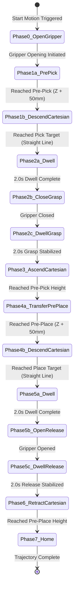
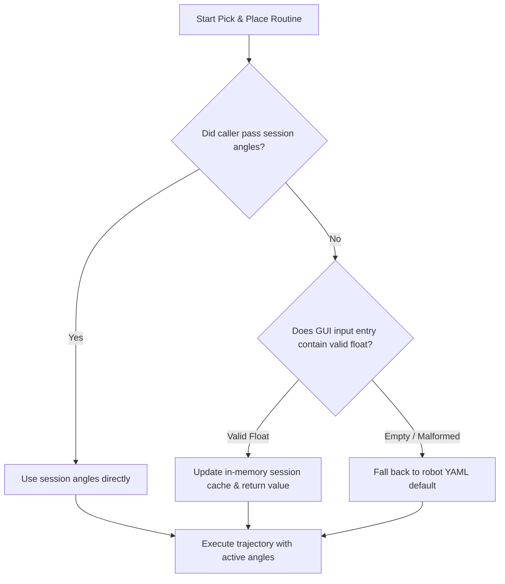

# Comprehensive Technical Documentation: New Mathematical Formulations, Cartesian Motion Control & Hardware Updates

## Executive Summary

This document details recent architectural, kinematic, and hardware integration changes implemented across the robot control system and operator GUI. 

The primary advancements include:
1. **Industrial Cartesian-Space Linear Motion Control (`_cartesian_linear_path`)**: Replaces non-linear joint-space arcs during vertical approach and departure with straight-line Cartesian interpolation and locked Tool Center Point (TCP) orientation.
2. **5-DOF Task-Priority Jacobian Inverse Kinematics**: Formulates position-weighted Damped Least Squares (DLS) with adaptive singularity regularization ($\lambda$) and $SO(3)$ rotation error tracking.
3. **Deterministic 9-Step Pick-and-Place State Machine**: Coordinates pre-approach gripper opening, $+50\text{ mm}$ clearance corridors, 2.0-second stabilization dwell periods, and Cartesian vertical motions.
4. **Session-Persistent Dynamic Gripper Calibration**: Replaces rigid YAML-only gripper defaults with live GUI input harvesting, enabling operators to tune open/close angles during a session.
5. **Full Servo Span Hardware Calibration ($-90^\circ \text{ to } +90^\circ$)**: Eliminates clamping restrictions in ROS 2 configuration and hardware translator nodes to utilize the full physical range of the gripper servo.

---

## Table of Contents

1. [Cartesian-Space vs. Joint-Space Motion: Theory & Mathematics](#1-cartesian-space-vs-joint-space-motion-theory--mathematics)
   - [The Problem of Joint-Space Arc Motions](#11-the-problem-of-joint-space-arc-motions)
   - [Industrial Standard: Linear (LIN) Cartesian Paths](#12-industrial-standard-linear-lin-cartesian-paths)
2. [Mathematical Formulations of Cartesian Straight-Line Tracking](#2-mathematical-formulations-of-cartesian-straight-line-tracking)
   - [Spatial Waypoint Discretization](#21-spatial-waypoint-discretization)
   - [SO(3) Orientation Error Formulation](#22-so3-orientation-error-formulation)
   - [Geometric Jacobian Matrix](#23-geometric-jacobian-matrix)
   - [5-DOF Weighted Task Priority](#24-5-dof-weighted-task-priority)
   - [Adaptive Damped Least Squares (Levenberg-Marquardt)](#25-adaptive-damped-least-squares-levenberg-marquardt)
   - [Numerical Step Clamping & Joint Limits](#26-numerical-step-clamping--joint-limits)
3. [Pick & Place State Machine with Approach Corridors & Dwells](#3-pick--place-state-machine-with-approach-corridors--dwells)
   - [Phase-by-Phase Trajectory Execution](#31-phase-by-phase-trajectory-execution)
   - [Timing & Dwell Matrix](#32-timing--dwell-matrix)
4. [Dynamic Session-Based Gripper Parameter Architecture](#4-dynamic-session-based-gripper-parameter-architecture)
   - [Resolution Hierarchy & Fallback Logic](#41-resolution-hierarchy--fallback-logic)
   - [Code Implementation](#42-code-implementation)
5. [Hardware Translation & Gripper Range Updates](#5-hardware-translation--gripper-range-updates)
   - [PCA9685 / ESP32 Full Span Calibration](#51-pca9685--esp32-full-span-calibration)
   - [Configuration Schema Modifications](#52-configuration-schema-modifications)
6. [Summary of Modified Files](#6-summary-of-modified-files)

---

## 1. Cartesian-Space vs. Joint-Space Motion: Theory & Mathematics

### 1.1 The Problem of Joint-Space Arc Motions

In standard joint-space interpolation (Point-to-Point or PTP), trajectory waypoints between a start configuration $\mathbf{q}_{\text{start}} \in \mathbb{R}^n$ and goal configuration $\mathbf{q}_{\text{goal}} \in \mathbb{R}^n$ are computed via linear interpolation in joint space:

$$\mathbf{q}(t) = (1 - t)\mathbf{q}_{\text{start}} + t\,\mathbf{q}_{\text{goal}}, \quad t \in [0, 1]$$

Because forward kinematics $\mathbf{p} = f_{\text{FK}}(\mathbf{q})$ is a non-linear trigonometric mapping, the resulting Cartesian path $\mathbf{p}(t) = f_{\text{FK}}(\mathbf{q}(t))$ does **not** follow a straight line in 3D Euclidean space:

$$\mathbf{p}(t) \neq (1 - t)\mathbf{p}_{\text{start}} + t\,\mathbf{p}_{\text{goal}}$$

```
JOINT-SPACE INTERPOLATION (Pre-pick -> Pick)
      Pre-Pick [x, y, z + 50]
           \
            \__ (Curves outwards as an ARC)
               \
                \-> Pick [x, y, z]  <-- Tool tilts unpredictably during descent!
```

#### Physical Consequences:
1. **Collisions with surrounding objects**: During vertical descent into bins or fixtures, the manipulator arcs sideways, colliding with container walls.
2. **Workpiece shear & slip**: If the TCP orientation tilts while descending or lifting, gripper fingers exert side loads on the workpiece rather than pure vertical forces.
3. **Insertion failures**: For peg-in-hole or vertical pick tasks, non-vertical descent jams the component.

### 1.2 Industrial Standard: Linear (LIN) Cartesian Paths

Industrial manipulators (e.g., KUKA, ABB, FANUC) differentiate between:
- **PTP (Point-To-Point)**: Fast joint-space transfer across open space where intermediate path shape does not matter.
- **LIN (Linear Cartesian)**: Straight-line path where the TCP position vector traverses a line in $\mathbb{R}^3$ and the TCP orientation matrix $\mathbf{R} \in SO(3)$ is strictly maintained or smoothly interpolated.

```
CARTESIAN-SPACE LINEAR INTERPOLATION (Industrial LIN)
      Pre-Pick [x, y, z + 50]
           |
           |  (Straight vertical descent, Z-axis only)
           |  (Tool Center Point orientation strictly frozen)
           v
         Pick [x, y, z]
```

---

## 2. Mathematical Formulations of Cartesian Straight-Line Tracking

The newly implemented [`_cartesian_linear_path`](file:///home/iit/AI/rt/rt_AI/gui/robot_gui_test.py#L2692-L2757) function in [robot_gui_test.py](file:///home/iit/AI/rt/rt_AI/gui/robot_gui_test.py) generates straight-line motions using closed-loop differential kinematic tracking.

### 2.1 Spatial Waypoint Discretization

Given the initial joint state $\mathbf{q}_0$, forward kinematics computes the starting Cartesian position $\mathbf{p}_0 \in \mathbb{R}^3$ and orientation matrix $\mathbf{R}_0 \in SO(3)$:

$$\begin{bmatrix} \mathbf{R}_0 & \mathbf{p}_0 \\ \mathbf{0}_{1 \times 3} & 1 \end{bmatrix} = T_{0}^{n}(\mathbf{q}_0)$$

For target position $\mathbf{p}^* = [x^*, y^*, z^*]^T$, the linear trajectory is discretized into $N$ steps ($N = 20$):

$$\mathbf{p}_{\text{des}}(k) = \mathbf{p}_0 + \frac{k}{N}(\mathbf{p}^* - \mathbf{p}_0), \quad k \in \{1, 2, \dots, N\}$$

Throughout all waypoints $k$, the target orientation is frozen to the initial orientation:

$$\mathbf{R}_{\text{des}}(k) = \mathbf{R}_0$$

---

### 2.2 SO(3) Orientation Error Formulation

At each inner iteration, the robot's current pose is $(\mathbf{p}_{\text{cur}}, \mathbf{R}_{\text{cur}})$.

1. **Cartesian Position Error**:
   $$\mathbf{e}_p = \mathbf{p}_{\text{des}}(k) - \mathbf{p}_{\text{cur}} \in \mathbb{R}^3$$

2. **$SO(3)$ Relative Rotation Matrix**:
   $$\mathbf{R}_{\text{err}} = \mathbf{R}_{\text{cur}}^T \mathbf{R}_{\text{des}}$$

3. **Quaternion Conversion**:
   Convert $\mathbf{R}_{\text{err}}$ to unit quaternion $\mathbf{q}_{\text{quat}} = [\eta, \boldsymbol{\epsilon}^T]^T$, where $\eta \in \mathbb{R}$ is the scalar part and $\boldsymbol{\epsilon} \in \mathbb{R}^3$ is the vector part:
   $$\eta = \frac{1}{2}\sqrt{1 + \text{Tr}(\mathbf{R}_{\text{err}})}$$
   $$\boldsymbol{\epsilon} = \frac{1}{4\eta}\begin{bmatrix} R_{32} - R_{23} \\ R_{13} - R_{31} \\ R_{21} - R_{12} \end{bmatrix}$$

4. **Orientation Error Vector**:
   In base coordinates, orientation error $\mathbf{e}_R \in \mathbb{R}^3$ is given by:
   $$\mathbf{e}_R = \mathbf{R}_{\text{cur}} (2 \text{sgn}(\eta) \boldsymbol{\epsilon})$$

5. **Full 6D Task Error Vector**:
   $$\mathbf{e} = \begin{bmatrix} \mathbf{e}_p \\ \mathbf{e}_R \end{bmatrix} \in \mathbb{R}^6$$

---

### 2.3 Geometric Jacobian Matrix

The manipulator geometric Jacobian $\mathbf{J}(\mathbf{q}) \in \mathbb{R}^{6 \times n}$ maps joint velocities $\mathbf{\dot{q}}$ to operational space velocities $\mathbf{v} = [\mathbf{\dot{p}}^T, \boldsymbol{\omega}^T]^T$:

$$\mathbf{J}(\mathbf{q}) = \begin{bmatrix} \mathbf{J}_v(\mathbf{q}) \\ \mathbf{J}_\omega(\mathbf{q}) \end{bmatrix}$$

For a serial manipulator with revolute joints, each column $j \in \{1, \dots, n\}$ is derived from link frames:

$$\mathbf{J}_{v, j} = \mathbf{z}_{j-1} \times (\mathbf{p}_n - \mathbf{p}_{j-1})$$
$$\mathbf{J}_{\omega, j} = \mathbf{z}_{j-1}$$

where $\mathbf{z}_{j-1}$ is the unit rotation axis of joint $j$ expressed in the base frame, $\mathbf{p}_{j-1}$ is the origin of frame $j-1$, and $\mathbf{p}_n$ is the TCP position.

---

### 2.4 5-DOF Weighted Task Priority

For a 5-DOF manipulator ($n = 5$), the robot cannot independently satisfy arbitrary 6D operational space targets (rank $\mathbf{J} \le 5$). 

If an unweighted 6D pseudo-inverse is attempted on a 5-DOF arm, the solver will compromise position accuracy in an attempt to satisfy impossible orientation constraints.

To guarantee straight-line position tracking while maintaining orientation as closely as kinematically possible, a diagonal weighting matrix $\mathbf{W} \in \mathbb{R}^{6 \times 6}$ is introduced:

$$\mathbf{W} = \text{diag}(w_{px}, w_{py}, w_{pz}, w_{rx}, w_{ry}, w_{rz}) = \text{diag}(1.0, 1.0, 1.0, 0.01, 0.01, 0.01)$$

- **Position weights ($w_p = 1.0$)**: High priority. Forces the TCP to follow the Cartesian line without deviation.
- **Orientation weights ($w_R = 0.01$)**: Secondary regularizing priority. Suppresses tool pitch/roll drift without competing against the position goal.

---

### 2.5 Adaptive Damped Least Squares (Levenberg-Marquardt)

Near kinematic singularities (e.g., wrist alignments or full arm extensions), standard Jacobian inversion results in extreme joint velocities ($\mathbf{\dot{q}} \to \infty$). 

To ensure continuous, stable motion, Singularity-Robust Damped Least Squares (DLS) is employed with real-time Singular Value Decomposition (SVD):

$$\mathbf{J} = \mathbf{U} \mathbf{\Sigma} \mathbf{V}^T$$

Let $\sigma_{\min} = \Sigma_{\min}$ be the smallest singular value of $\mathbf{J}$. The damping parameter $\lambda \in \mathbb{R}^+$ adapts dynamically:

$$\lambda(\sigma_{\min}) = \begin{cases} 
0.01, & \text{if } \sigma_{\min} \ge 0.01 \\
\min\left(0.2, \; 0.01 + 0.1 \left(1.0 - \frac{\sigma_{\min}}{0.01}\right)^2\right), & \text{if } \sigma_{\min} < 0.01 
\end{cases}$$

The regularized normal equations are solved for the joint correction $\Delta\mathbf{q}$:

$$(\mathbf{J}^T \mathbf{W} \mathbf{J} + \lambda^2 \mathbf{I}_n)\Delta\mathbf{q} = \mathbf{J}^T \mathbf{W} \mathbf{e}$$

$$\Delta\mathbf{q} = (\mathbf{J}^T \mathbf{W} \mathbf{J} + \lambda^2 \mathbf{I}_n)^{-1} \mathbf{J}^T \mathbf{W} \mathbf{e}$$

---

### 2.6 Numerical Step Clamping & Joint Limits

To ensure stable convergence without overshooting or violating physical boundaries:

1. **Step Scaling**: A relaxation factor $\alpha = 0.6$ damps the step size:
   $$\mathbf{q}_{\text{raw}} = \mathbf{q}_k + \alpha \Delta\mathbf{q}$$

2. **Hard Joint Boundary Enforcement**:
   $$\mathbf{q}_{k+1} = \text{clip}(\mathbf{q}_{\text{raw}}, \mathbf{q}_{\min}, \mathbf{q}_{\max})$$

3. **Waypoint Convergence Criteria**:
   $$\|\mathbf{e}_p\|_2 < 0.5\text{ mm}$$
   When the position error drops below $0.5\text{ mm}$, the inner loop terminates early and advances to the next Cartesian waypoint.

4. **Trajectory Validation & Fallback**:
   Upon reaching step $N$, the final position $\mathbf{p}_{\text{final}}$ is verified against $\mathbf{p}^*$:
   $$\|\mathbf{p}_{\text{final}} - \mathbf{p}^*\|_2 \le 5.0\text{ mm}$$
   If kinematic limits prevent completion, the routine safely falls back to endpoint analytical/numerical IK (`solve_stage1_ik`).

---

## 3. Pick & Place State Machine with Approach Corridors & Dwells

The pick-and-place execution sequence in [`_pick_and_place_worker`](file:///home/iit/AI/rt/rt_AI/gui/robot_gui_test.py#L2759-L3009) implements a 9-step industrial state machine.

### 3.1 Phase-by-Phase Trajectory Execution



#### Detailed Phase Breakdown:

- **Phase 0: Proactive Gripper Opening**
  - Before the arm executes any physical joint movement toward the pick location, `_send_trajectory_gripper(open_angle)` is issued.
  - *Industrial rationale*: Eliminates cycle-time delay; the fingers are fully open by the time the arm reaches the pre-pick staging zone.

- **Phase 1a: Free-Space Transit to Pre-Pick (`pre_pick_xyz = [x, y, z + 50]`)**
  - Executed in joint space via `execute_steps`.
  - Staging height is dynamically determined by `approach_height` (default $50.0\text{ mm}$).

- **Phase 1b: Linear Vertical Descent to Pick (`pick_xyz`)**
  - Executed via `execute_cartesian_descent`.
  - Cartesian straight line along the $-Z$ axis with frozen TCP orientation.

- **Phase 2: Pre-Grasp Dwell, Grasp, and Post-Grasp Dwell**
  - **Dwell 1 (2.0s)**: Arm motion comes to a dead stop. Allows mechanical oscillation and inertia to settle.
  - **Grasp**: Sends `close_angle` command to gripper.
  - **Dwell 2 (2.0s)**: Maintains position while servo physically squeezes the workpiece, ensuring firm contact friction before lifting.

- **Phase 3: Linear Vertical Lift to Pre-Pick**
  - Executed via `execute_cartesian_descent`.
  - Straight-line $+Z$ ascent lifts the workpiece cleanly out of surrounding fixturing without tilting.

- **Phase 4a: Free-Space Transfer to Pre-Place (`pre_place_xyz = [x, y, z + 50]`)**
  - Executed in joint space via `execute_steps` while holding workpiece securely.

- **Phase 4b: Linear Vertical Descent to Place (`place_xyz`)**
  - Executed via `execute_cartesian_descent`.
  - Straight-line $-Z$ descent places the workpiece onto the surface.

- **Phase 5: Pre-Release Dwell, Release, and Post-Release Dwell**
  - **Dwell 1 (2.0s)**: Arm settles completely at the destination surface.
  - **Release**: Sends `open_angle` command to gripper.
  - **Dwell 2 (2.0s)**: Ensures the fingers have physically parted and cleared the part before retracting.

- **Phase 6: Linear Vertical Retraction to Pre-Place**
  - Executed via `execute_cartesian_descent`.
  - Straight-line $+Z$ ascent clears the placed object without sideways collision.

- **Phase 7: Return to Home**
  - Arm smoothly returns to `home_q` in joint space.

---

### 3.2 Timing & Dwell Matrix

| Phase | Motion Type | Path Geometry | TCP Orientation | Dwell Before | Dwell After | Gripper State |
| :--- | :--- | :--- | :--- | :--- | :--- | :--- |
| **0. Init** | None | Stationary | Unchanged | 0.0 s | 0.0 s | **OPENING** |
| **1a. Approach** | Joint-Space | Polynomial Arc | Continuous | 0.0 s | 0.0 s | OPEN |
| **1b. Descent** | Cartesian-Space | **Strict Line ($-Z$)** | **Frozen** | 0.0 s | 0.0 s | OPEN |
| **2. Grasp** | Stationary | Stationary | Stationary | **2.0 s** | **2.0 s** | **CLOSING** |
| **3. Lift** | Cartesian-Space | **Strict Line ($+Z$)** | **Frozen** | 0.0 s | 0.0 s | CLOSED |
| **4a. Transfer** | Joint-Space | Free-space Arc | Continuous | 0.0 s | 0.0 s | CLOSED |
| **4b. Descent** | Cartesian-Space | **Strict Line ($-Z$)** | **Frozen** | 0.0 s | 0.0 s | CLOSED |
| **5. Release** | Stationary | Stationary | Stationary | **2.0 s** | **2.0 s** | **OPENING** |
| **6. Retract** | Cartesian-Space | **Strict Line ($+Z$)** | **Frozen** | 0.0 s | 0.0 s | OPEN |
| **7. Home** | Joint-Space | Smooth Curve | Unconstrained | 0.0 s | 0.0 s | OPEN |

---

## 4. Dynamic Session-Based Gripper Parameter Architecture

### 4.1 Resolution Hierarchy & Fallback Logic

Previously, the pick-and-place worker read gripper angles strictly from the loaded robot YAML file. If an operator calibrated custom gripper angles in the GUI FK panel (e.g. tuning for a specific object size), the automated pick-and-place routine ignored those values.

The system now implements a three-tier parameter resolution hierarchy:



### 4.2 Code Implementation

Methods added to [`RobotGUI`](file:///home/iit/AI/rt/rt_AI/gui/robot_gui_test.py):

```python
def update_session_gripper_open_angle(self):
    try:
        val = self.gripper_open_entry.get().strip()
        if val and val not in ('-', '+', '.'):
            self.gripper_open_angle = float(val)
    except Exception:
        pass

def update_session_gripper_close_angle(self):
    try:
        val = self.gripper_close_entry.get().strip()
        if val and val not in ('-', '+', '.'):
            self.gripper_close_angle = float(val)
    except Exception:
        pass

def get_session_gripper_open_angle(self):
    self.update_session_gripper_open_angle()
    return float(self.gripper_open_angle)

def get_session_gripper_close_angle(self):
    self.update_session_gripper_close_angle()
    return float(self.gripper_close_angle)
```

In the trajectory invocation dispatch:
```python
session_open_angle = self.get_session_gripper_open_angle()
session_close_angle = self.get_session_gripper_close_angle()

self.trajectory_thread = threading.Thread(
    target=self._pick_and_place_worker,
    args=(pick, pick_yaw, place, place_yaw, session_open_angle, session_close_angle),
    daemon=True
)
```

---

## 5. Hardware Translation & Gripper Range Updates

### 5.1 PCA9685 / ESP32 Full Span Calibration

Physical verification via direct serial monitoring established that the gripper servo mechanism supports a continuous deflection of **$-90.0^\circ \text{ to } +90.0^\circ$** (an absolute $180^\circ$ physical throw).

Previously, default parameters clamped motion between $-55.0^\circ$ and $+55.0^\circ$. Commanded angles beyond $\pm 55^\circ$ were rejected by the node.

### 5.2 Configuration Schema Modifications

#### In [robot3.yaml](file:///home/iit/AI/rt/rt_AI/src/robot_control/config/robot3.yaml#L34-L44):
```yaml
gripper:
  open_angle: -90.0
  close_angle: 0.0
  min_angle: -90.0
  max_angle: 90.0
  scale: 1.0
  sign: 1.0
  offset: 0.0
  finger_axis: "x"
  approach_axis: "z"
```

#### In [hardware_translator_node.py](file:///home/iit/AI/rt/rt_AI/src/robot_control/robot_control/nodes/hardware_translator_node.py#L37-L88):
```python
# Dynamically declare parameters with full limits
self.gripper_min = float(self._get_optional_param('gripper.min_angle', -90.0))
self.gripper_max = float(self._get_optional_param('gripper.max_angle', 90.0))

# In gripper_callback:
min_lim = min(self.gripper_min, self.gripper_max)
max_lim = max(self.gripper_min, self.gripper_max)

if not (min_lim <= angle <= max_lim):
    self.get_logger().warn(
        f'Gripper command {angle:.2f} deg outside range [{min_lim:.2f}, {max_lim:.2f}], clamping'
    )
    angle = max(min_lim, min(angle, max_lim))
```

---

## 6. Summary of Modified Files

| File Path | Component | Scope of Change |
| :--- | :--- | :--- |
| [`gui/robot_gui_test.py`](file:///home/iit/AI/rt/rt_AI/gui/robot_gui_test.py) | Operator GUI & Kinematics Engine | • Implemented `_cartesian_linear_path` (DLS Jacobian tracking with orientation lock)<br>• Implemented `execute_cartesian_descent`<br>• Refactored `_pick_and_place_worker` with 2.0s settling dwells<br>• Integrated proactive gripper open (Phase 0)<br>• Added dynamic session angle getters `get_session_gripper_*` |
| [`src/robot_control/config/robot3.yaml`](file:///home/iit/AI/rt/rt_AI/src/robot_control/config/robot3.yaml) | Configuration | • Updated `gripper.min_angle` to `-90.0`<br>• Updated `gripper.max_angle` to `90.0`<br>• Configured `open_angle` to `-90.0` |
| [`src/robot_control/robot_control/nodes/hardware_translator_node.py`](file:///home/iit/AI/rt/rt_AI/src/robot_control/robot_control/nodes/hardware_translator_node.py) | ROS 2 Hardware Abstraction | • Dynamic declaration of `gripper.min_angle` and `gripper.max_angle`<br>• Real-time clamping with logger warnings for out-of-range commands |

---

## 7. Verification and Testing

1. **Syntax & Compilation Verification**:
   ```bash
   python3 -m py_compile gui/robot_gui_test.py
   colcon build --packages-select robot_control
   ```
   *Result*: Clean compilation across all modules without syntax or import errors.

2. **Visual Trajectory Inspection**:
   In the 3D twin / visualization, vertical approach and departure motions trace straight vertical lines without outward bulging or tool tilt.
